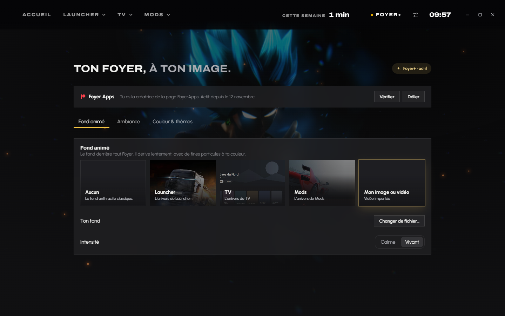

  

<h1 align="center">Foyer</h1>

<b>Tes jeux, ta télé et tes mods. Une seule app.</b>

  
  
  

<h3 align="center">
  <a href="https://github.com/foyerapps/foyer/releases/latest/download/Foyer-Hub-Setup.exe">⬇ Télécharger Foyer pour Windows</a>
</h3>

Gratuit · sans pub · tes données restent sur ton PC

---

## L'accueil

Le dernier jeu lancé prend tout l'écran, avec son vrai logo. Un clic sur une jaquette et tout suit. À droite, ce qui compte en ce moment : la musique qui joue, le prochain Grand Prix de F1 (essais, qualifs, course), le prochain match de tes équipes et tes apps préférées. En haut, le temps de jeu de la semaine.

Survole **Launcher**, **TV** ou **Mods** : leur menu s'ouvre, tu vas directement où tu veux.

## Launcher : tous tes jeux

Steam, Epic, Riot, GOG, Xbox, EA, Ubisoft et les jeux installés à la main, dans une seule bibliothèque. Ce que tu peux reprendre, les bons plans de ta wishlist, les jeux qui dorment depuis trop longtemps.

  

  
  

**Soirée** croise ta bibliothèque et celles de tes potes pour trouver à quoi jouer ensemble, même ce qui est gratuit pour tout le monde. **Promotions** suit les prix de ta wishlist.

## TV : ton abonnement IPTV

Les chaînes en direct avec le guide des programmes, ce qui passe en ce moment, les films et les séries avec leur carrousel « À la une », ta liste, la recherche. Sur le PC, dans Foyer ou dans sa propre fenêtre, et sur ta **télé Android** : Foyer l'installe et la met à jour en Wi-Fi, depuis l'onglet TV.

Foyer TV ne fournit aucune chaîne : il lit l'abonnement IPTV que tu as déjà (adresse, identifiant, mot de passe).

## Mods : glisse, c'est installé

Glisse un mod dans la fenêtre, il part au bon endroit : **Assetto Corsa**, **Le Mans Ultimate**, **F1 25** (via Swofty) et **Euro Truck Simulator 2**.

  

## Foyer+

Tout ce qui est utile reste gratuit. **Foyer+**, c'est le bonus pour soutenir le projet sur **[Patreon](https://www.patreon.com/cw/FoyerApps)** : un fond animé (l'univers de tes jeux, de la TV, ou ta propre image ou vidéo), des ambiances (neige, lucioles, braises…), un mode soirée qui tamise tout après 22 h, ta couleur, et tes statistiques détaillées.

  

## Installer

1. Télécharge **[Foyer-Hub-Setup.exe](https://github.com/foyerapps/foyer/releases/latest/download/Foyer-Hub-Setup.exe)** et lance-le : Foyer s'installe et s'ouvre tout seul.
2. Si Windows affiche « Windows a protégé votre ordinateur », clique sur **Informations complémentaires**, puis **Exécuter quand même** (Foyer n'est pas encore signé, c'est un petit projet indépendant).
3. Au premier lancement, choisis ce dont tu as besoin : Launcher, TV, Mods. Le reste ne tourne pas.

Les mises à jour arrivent toutes seules. Le fichier `Foyer-Hub-Setup.exe.sha256` de chaque version contient l'empreinte du setup, pour vérifier qu'il n'a pas été modifié.

**Tu avais Foyer Launcher, Foyer TV pour PC ou Foyer Mods ?** Ils sont maintenant dans Foyer. Installe Foyer, puis désinstalle-les depuis les Paramètres de Windows. L'app Foyer TV pour la télé Android, elle, reste une app à part : Foyer l'installe pour toi.

## Vie privée

Tes données restent sur ton PC. Pas de pub, pas de revente de données. La connexion Patreon et Steam se fait sur leurs sites : Foyer ne voit jamais ton mot de passe. Tes identifiants IPTV sont chiffrés sur ton PC.
