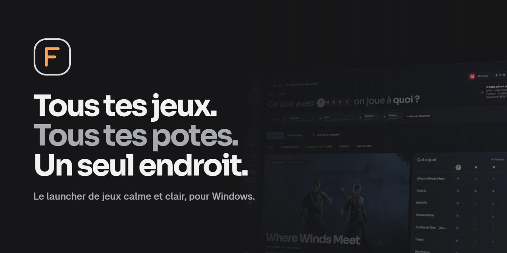
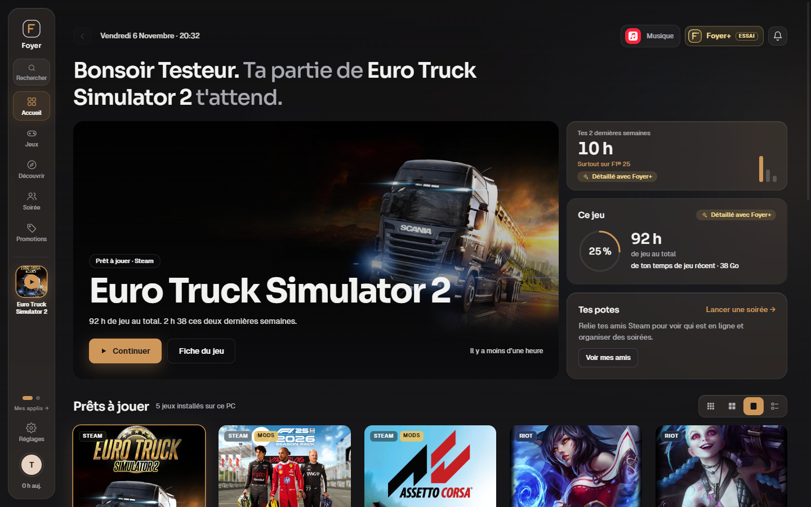
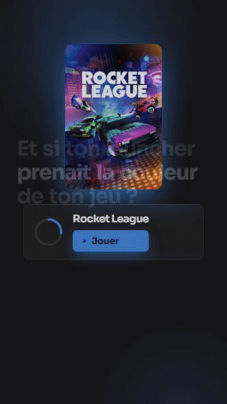
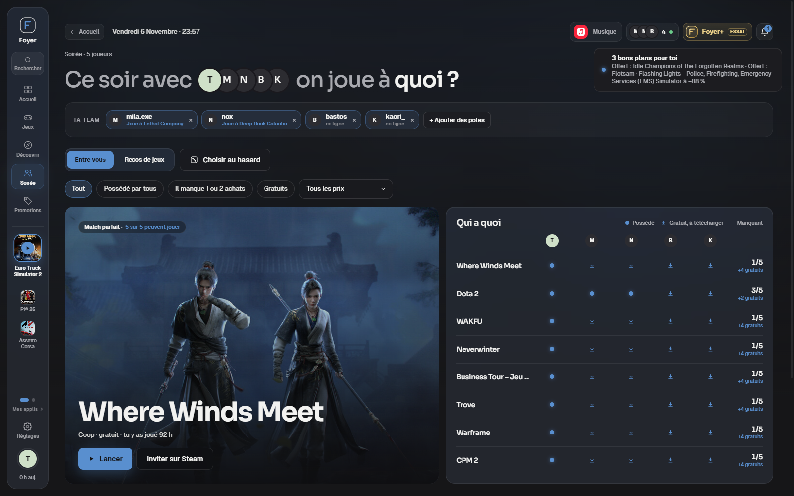
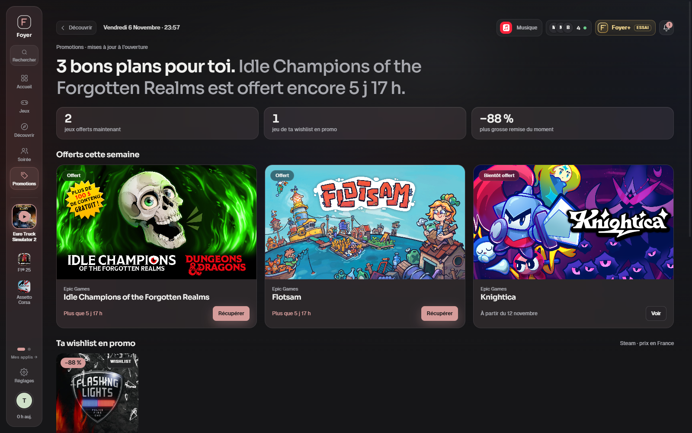
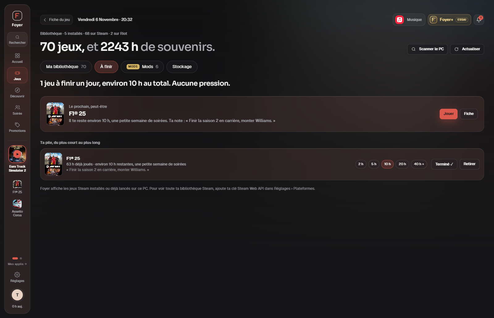
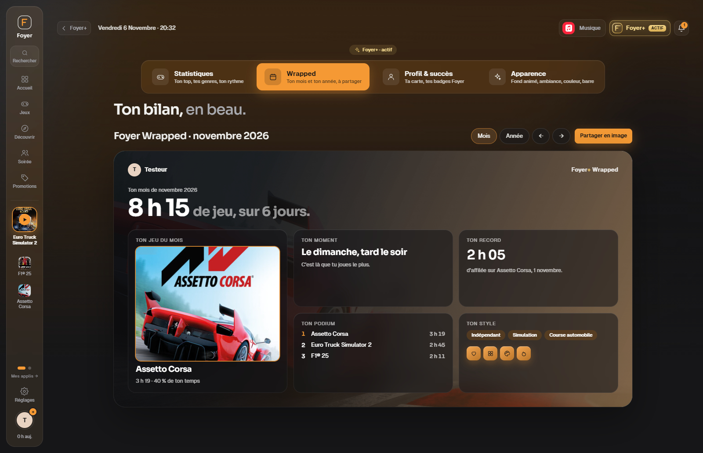
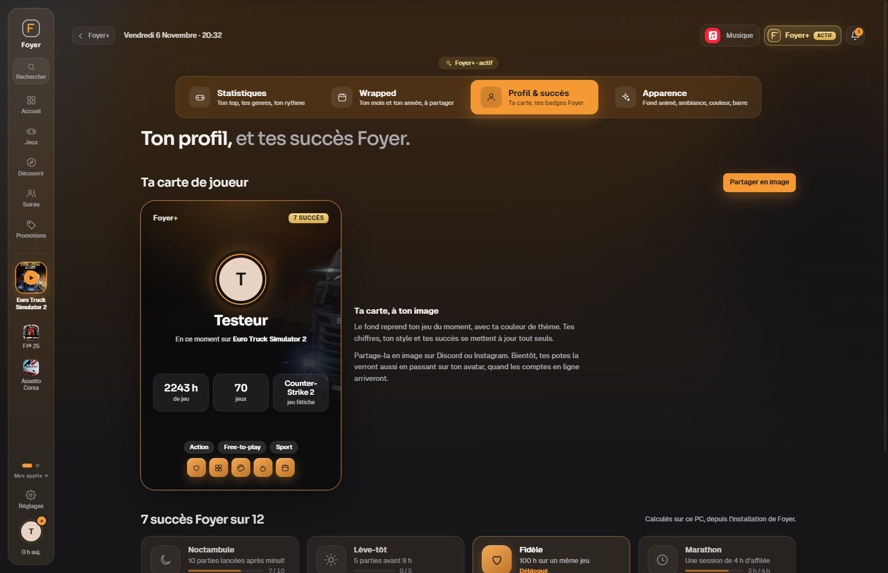

  

  
  
  

<h3 align="center">
  <a href="https://github.com/foyerapps/foyer/releases/latest/download/Foyer-Setup.exe">⬇ Télécharger Foyer pour Windows</a>
</h3>

Gratuit · sans pub · installation en un clic

---

Tu as Steam, Epic, Battle.net, Riot, Xbox… et tu ne sais plus où sont tes jeux. **Foyer les réunit dans une seule appli**, calme et claire. Les launchers d'origine ne démarrent qu'au moment de jouer, en arrière-plan. Et le soir, **Soirée** te dit à quoi jouer avec tes potes.

  

## Le jeu donne le thème

Foyer prend la couleur de la jaquette de ton jeu : boutons, jauges, reflets, tout s'accorde. Chaque jeu a son ambiance.

## Soirée : « on joue à quoi ce soir ? »

Choisis tes potes. Foyer croise vos bibliothèques et te montre ce que tout le monde peut lancer : les jeux possédés par tous, les gratuits, et ceux où il ne manque qu'un achat. Pas d'idée ? **Choisir au hasard**.

## Tout ce qu'il te faut, rien de plus

<table>
  <tr>
    <td width="50%" valign="top">
      
      <h3>Promotions</h3>
      Les jeux offerts de la semaine et ta wishlist en promo. Foyer te prévient, tu ne rates plus rien.
    </td>
    <td width="50%" valign="top">
      
      <h3>Fiche jeu et Reprendre</h3>
      Le dernier patch trié (nouveautés, équilibrage, correctifs), les captures, et une note pour te souvenir où tu en étais.
    </td>
  </tr>
  <tr>
    <td width="50%" valign="top">
      
      <h3>À finir</h3>
      Ta pile de jeux pas finis, du plus court au plus long. Aucune pression.
    </td>
    <td width="50%" valign="top">
      
      <h3>Foyer Wrapped</h3>
      Ton mois et ton année de jeu en une image, à partager. (Foyer+)
    </td>
  </tr>
</table>

Et aussi : **lancement discret** (Steam démarre caché, Foyer se fait oublier pendant ta partie), **Stockage** (les jeux installés que tu ne lances plus), **Découvrir** (des recos basées sur ton vrai temps de jeu), tes **mods**, ta **musique**, tes **applis** et la recherche **Ctrl K**.

## Tes launchers

| Plateforme | Ce que Foyer voit |
|---|---|
| **Steam** | Toute ta bibliothèque (avec ta clé Steam), tes amis et leurs jeux |
| **Riot Games** | League of Legends, TFT |
| **Epic Games, GOG, Ubisoft Connect, Battle.net, Xbox (Game Pass PC), EA app** | Les jeux **installés** |
| **Ton PC** | Les jeux installés hors launcher, trouvés par « Scanner le PC » |

Epic, GOG, Ubisoft, Battle.net, Xbox et EA ne permettent pas de récupérer toute ta bibliothèque : seuls les jeux installés apparaissent.

## Installer

1. Télécharge **[`Foyer-Setup.exe`](https://github.com/foyerapps/foyer/releases/latest/download/Foyer-Setup.exe)** (ou `Foyer.exe`, la version portable sans installation, dans les [Releases](https://github.com/foyerapps/foyer/releases/latest)).
2. Lance-le. Si Windows affiche « Windows a protégé votre ordinateur », clique sur **Informations complémentaires**, puis **Exécuter quand même**. C'est normal pour une petite appli qui n'a pas encore de certificat de signature.
3. Quand une nouvelle version sort, Foyer te prévient avec un bouton **Télécharger**. Tes jeux et tes réglages sont gardés.

## Foyer+

Tout ce qui est utile est gratuit, pour toujours. **Foyer+** ajoute du bonus pour soutenir le projet : Foyer Wrapped, stats détaillées, carte de joueur et succès, fonds animés, ambiances, thèmes. Il s'active sur **[Patreon](https://www.patreon.com/cw/FoyerApps)** (3 € par mois).

## Vie privée

Tes données restent sur ton PC. Ta clé Steam est chiffrée par Windows. Les connexions Steam et Patreon se font sur leurs sites officiels : Foyer ne voit jamais tes mots de passe. Pas de pub, pas de revente de données.

---

Foyer n'est affilié ni à Valve, ni à Riot Games, ni à Epic Games, ni aux autres éditeurs cités. Leurs noms, jeux et visuels appartiennent à leurs propriétaires respectifs.
