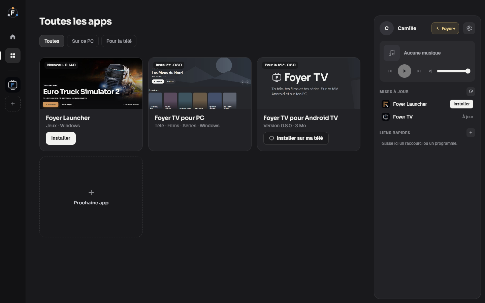
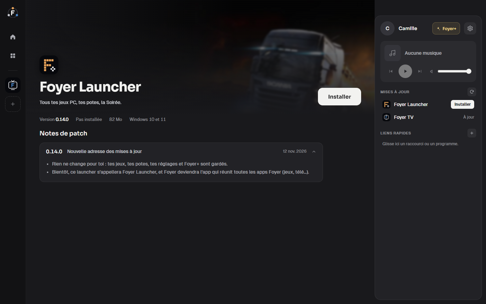
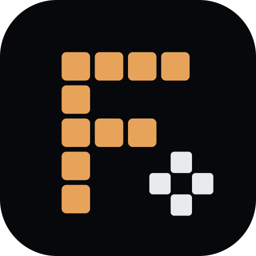
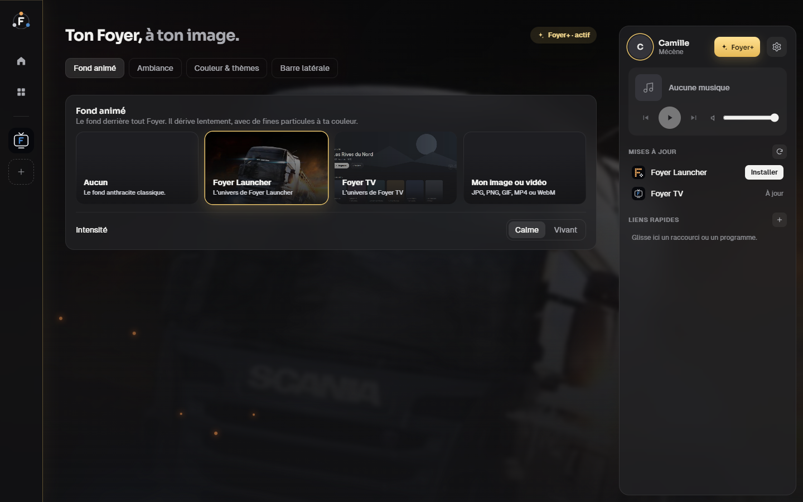
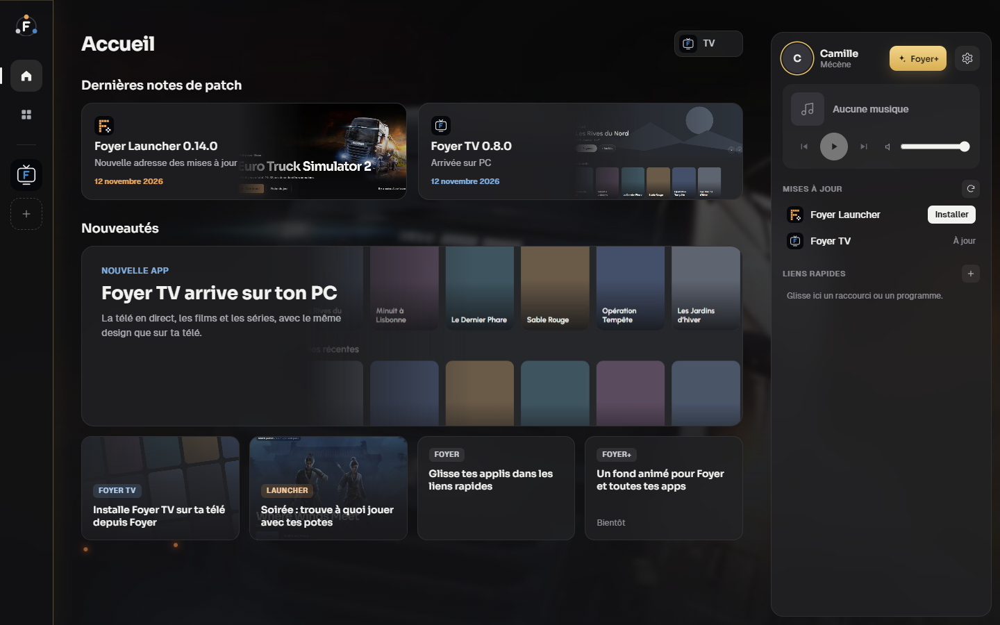

  

  
  
  

<h3 align="center">
  <a href="https://github.com/foyerapps/foyer/releases/latest/download/Foyer-Hub-Setup.exe">⬇ Télécharger Foyer pour Windows</a>
</h3>

Gratuit · sans pub · tes données restent sur ton PC

---

**Foyer** est la maison de toutes les apps Foyer. Il les installe, les met à jour et les lance en un clic, et il réunit au même endroit ce que tu utilises tous les jours : tes liens rapides vers tes applis préférées et le contrôle de ta musique.

  

## Tes apps, toujours à jour

Chaque app installée a sa place dans la barre de gauche : survole son icône pour la lancer. À l'accueil, les **notes de patch** de chaque app te disent ce qui a changé. Les mises à jour arrivent toutes seules, en un clic.

  

## Une page par app

Une grande image, un gros bouton Lancer, la version, et toutes les notes de patch. Le menu ⋯ ouvre son dossier ou la désinstalle proprement.

  

## Les apps Foyer

| | App | Pour quoi faire | Télécharger seule |
|---|---|---|---|
|  | **[Foyer Launcher](https://github.com/foyerapps/foyer-launcher)** | Tous tes jeux PC (Steam, Epic, Riot, GOG…) et tes potes, au même endroit. La Soirée te dit à quoi jouer ensemble. | [Foyer-Setup.exe](https://github.com/foyerapps/foyer-launcher/releases/latest/download/Foyer-Setup.exe) |
|  | **[Foyer TV](https://github.com/foyerapps/foyer-tv)** | Ton abonnement IPTV sur ton PC et sur ta télé Android : chaînes, guide des programmes, films et séries. | [FoyerTV-Setup.exe](https://github.com/foyerapps/foyer-tv/releases/latest/download/FoyerTV-Setup.exe) · [FoyerTV.apk](https://github.com/foyerapps/foyer-tv/releases/latest/download/FoyerTV.apk) |

Avec Foyer, tu n'as rien à télécharger toi-même : tout s'installe depuis l'écran **Toutes les apps**, même Foyer TV sur ta télé Android, en Wi-Fi.

## Foyer+

Tout ce qui est utile reste gratuit. **Foyer+**, c'est le bonus, pour soutenir le projet sur **[Patreon](https://www.patreon.com/cw/FoyerApps)** : un fond animé à l'image de tes apps ou de ta propre image, des ambiances (neige, lucioles, braises…), un mode soirée qui tamise tout après 22 h, ta couleur, des thèmes de barre, et des thèmes à partager avec tes potes.

  
  

## Installer

1. Télécharge **[Foyer-Hub-Setup.exe](https://github.com/foyerapps/foyer/releases/latest/download/Foyer-Hub-Setup.exe)** et lance-le : Foyer s'installe et s'ouvre tout seul.
2. Si Windows affiche « Windows a protégé votre ordinateur », clique sur **Informations complémentaires**, puis **Exécuter quand même** (Foyer n'est pas encore signé, c'est un petit projet indépendant).

Le fichier `Foyer-Hub-Setup.exe.sha256` de chaque version contient l'empreinte du setup, pour vérifier qu'il n'a pas été modifié.

## Vie privée

Tes données restent sur ton PC. Pas de pub, pas de revente de données. La connexion Patreon se fait sur le site de Patreon : Foyer ne voit jamais ton mot de passe.
